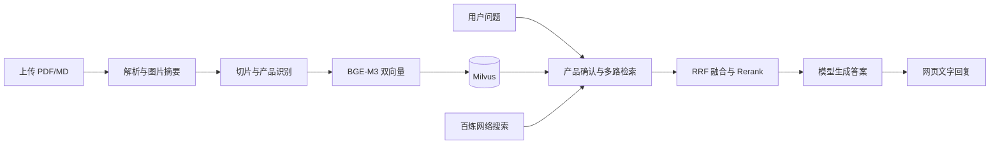

# 掌柜智库 · 产品手册 RAG 问答系统

基于 Python、FastAPI 和 LangGraph 的知识库应用。支持 PDF/Markdown 导入、图文内容解析、混合向量检索、联网搜索以及多轮流式问答。

本项目是基于尚硅谷“掌柜智库”课程开展的个人实践，完成了本地部署、流程核验、集成排错及页面展示调整。

## 主要功能

- **文档导入**：保存文件，调用 MinerU 解析 PDF，提取图片和 Markdown。
- **图片理解**：通过多模态模型生成图片摘要，并将图片保存到 MinIO。
- **知识入库**：按标题和长度切片，识别产品名称，用 BGE-M3 生成稠密与稀疏向量，写入 Milvus。
- **多路检索**：产品确认和问题改写后，并行执行普通检索、HyDE 检索和百炼 MCP 网络搜索。
- **融合与生成**：RRF 融合本地结果，与网络结果合并后进行 Rerank 精排，再生成答案。
- **交互展示**：SSE 流式输出、节点进度、MongoDB 会话历史、Markdown 渲染；当前界面仅显示文字。

## 技术栈

| 类别 | 技术 |
|---|---|
| 后端与编排 | Python 3.11+、FastAPI、LangGraph、LangChain |
| 文档处理 | MinerU、多模态大模型 |
| 向量与检索 | BGE-M3、Milvus、稠密/稀疏混合检索、HyDE、RRF |
| 云端能力 | 百炼 MCP WebSearch、DashScope TextReRank、OpenAI 兼容模型接口 |
| 数据存储 | MinIO、Milvus、MongoDB |
| 前端 | HTML/CSS/JavaScript、SSE、内嵌 Marked |
| 依赖管理 | uv、PyTorch |

## 工作流程



详细节点和数据流见 [架构说明](docs/architecture.md)。

## 目录结构

```text
config/       模型、存储、MCP 与重排配置
processor/    导入与问答两张 LangGraph 工作流
utils/        向量、存储、历史、SSE 与任务工具
tool/         日志与模型下载工具
web/api/      FastAPI 导入、问答服务
web/page/     导入与聊天页面
docs/         架构说明
.env.example  配置模板
pyproject.toml
uv.lock
```

## 运行前准备

1. 安装 Python 3.11+ 和 uv。
2. 准备可访问的 MinIO、Milvus 和 MongoDB 服务。
3. 准备 MinerU Token，以及模型、百炼搜索和重排所需的服务权限与 API Key。
4. 下载 BGE-M3 并配置实际模型路径。

当前依赖配置的 PyTorch 源为 CUDA 12.8。请根据本机硬件准备兼容的运行环境；CPU 环境还需要调整对应的 PyTorch 依赖源和模型设备配置。

## 启动方式（Windows PowerShell）

在项目根目录安装依赖并创建配置：

```powershell
uv sync
Copy-Item .env.example .env
```

编辑 `.env`，填写服务地址、密钥、可用模型名称和本地 BGE-M3 路径。示例使用 localhost，外部服务部署在其他机器时需填写实际地址。

可使用下载脚本获取模型，随后将打印出的实际目录填写到 `BGE_M3_PATH`：

```powershell
.\.venv\Scripts\python.exe -m tool.download_bgem3
```

在第一个终端启动导入服务：

```powershell
.\.venv\Scripts\python.exe -m uvicorn web.api.import_service:app --host 127.0.0.1 --port 8000
```

在另一个项目根目录终端启动问答服务：

```powershell
.\.venv\Scripts\python.exe -m uvicorn web.api.query_service:app --host 127.0.0.1 --port 8001
```

- 导入页面：<http://127.0.0.1:8000/import.html>
- 问答页面：<http://127.0.0.1:8001/chat.html>
- 导入 API 文档：<http://127.0.0.1:8000/docs>
- 问答 API 文档：<http://127.0.0.1:8001/docs>

先上传文档并确认入库，再围绕已导入的产品型号提问。

## 数据保存位置

| 存储 | 内容 |
|---|---|
| `DATA_BASED_ROOT_DIR/日期/task_id/` | 上传文件、解析 ZIP、Markdown、图片、切片 JSON |
| MinIO | 原文件与图片 |
| Milvus `kb_item_names` | 产品名称与产品名向量 |
| Milvus `kb_chunks` | 切片正文、元数据、1024 维稠密向量及稀疏向量 |
| MongoDB | 多轮会话历史 |

`chunks.json` 在向量化之前生成，属于文本切片备份。任务状态和 SSE 队列位于进程内存，当前版本按单进程运行。

## 已完成的实践与验证

- 核验原文件和图片在 MinIO 中的内容哈希。
- 比对本地切片内容和 Milvus 中同文档的记录。
- 检查向量维度、非零值与索引状态，并实际执行稠密、稀疏向量检索。
- 修复百炼 MCP 端点与客户端传输协议不匹配的问题。
- 修复切片 JSON 备份路径，完善 Markdown 渲染与纯文字展示。

## 当前实现边界

- 部分辅助步骤报错后会继续执行，需结合日志和实际存储核验结果。
- MCP 搜索失败目前可能中断检索问答流程。
- 同标题文档采用更新现有数据的方式处理。
- 当前没有跨 MinIO、Milvus 和 MongoDB 的事务机制。

## 来源与第三方组件

课程来源：尚硅谷“掌柜智库”项目实践。第三方组件遵循其各自许可证；聊天页面内嵌的 Marked 保留了原许可证说明。

仓库仅包含应用代码、依赖声明和示例配置，不包含实际密钥、本地虚拟环境、上传资料、模型权重或运行产物。
